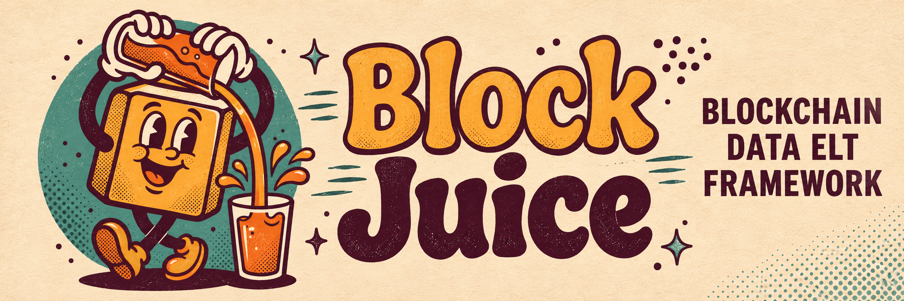

# BlockJuice

[](https://github.com/iankressin/block-juice/actions/workflows/ci.yml)



A self-hosted ELT framework and warehouse for blockchain data. You can trace any number it gives you back to raw rows, and rebuild it.

If you advise funds, treasuries or protocol teams, you know where on-chain work gets awkward. Explorers are fine for a quick look. Shared analytics platforms work until you need to own the query, the join or how long the data is kept.

BlockJuice runs in your environment. It loads chain data into your Postgres, transforms it with dbt and schedules the work with Dagster. Balances, transfers, trades and labels sit next to the rest of your data, under keys and policies you set.

The result is a pipeline an analyst can read, change and hand to a client. Every step is in the repo for anyone to check.

## Why

You keep the data. Raw rows, marts, run logs and answers live in a warehouse and repo you run. When an auditor or a client asks how a number was built, you can show them the model and the run that produced it.

You can ask in plain language. The repo's [Claude Code skill](#claude-code-skill) (`/bj <question>`) maps the question onto marts, and builds any that are missing. It runs the analysis through the `bj` CLI and writes `answers/<slug>/` with the value, the checks and the method. From there it can make a PDF, a spreadsheet or a Google Doc.

Adding coverage doesn't mean building a platform. For another wallet list, EVM chain or protocol, copy a source with `bj new-source`, regenerate `sources.json`, add the chain in dbt (see [transformation/README.md](transformation/README.md)) and schedule a pipeline. The [glossary](GLOSSARY.md) explains call sources and stream sources. The shared library already handles cursors and dead letters, so you can spend your time on the question.

When something breaks, you can see it. `bj doctor` checks your env and services before you start debugging. Grafana and the `ops.*` run log show ingestion and dbt side by side. The library keeps failed calls as dead letters instead of dropping them.

## What

Every table below lives in the `analytics` schema of your warehouse. A source reads only the wallets, tokens and feeds you list in its `addresses.json`, so each table covers the addresses you follow, not the whole chain. Every row traces back to the raw rows in `raw.<source>_<table>` it was built from, and one Dagster job per pipeline rebuilds its tables each day at 06:00 UTC.

The grid shows which chains each table covers. The cards after it say what a row is, where it comes from and which columns it has.

| | Ethereum | Arbitrum | Base | Solana | Bitcoin | Binance, Coinbase |
|---|:---:|:---:|:---:|:---:|:---:|:---:|
| [Balances](#balances) | ✓ | | | ✓ | ✓ | |
| [Transfers](#transfers) | ✓ | ✓ | ✓ | | | |
| [DEX trades](#dex-trades) | ✓ | | | | | |
| [Bridges](#bridges) | | ✓ | ✓ | | | |
| [Labels](#labels) | | ✓ | ✓ | | | |
| [Tokens](#tokens) | ✓ | ✓ | ✓ | | | |
| [Exchange prices](#exchange-prices) | | | | | | ✓ |
| [Oracle prices](#oracle-prices) | ✓ | ✓ | ✓ | | | |

<table>
<tr>
<td width="50%" valign="top">

### Balances

`analytics.latest_balances`

Each wallet's latest balance of each asset, in the asset's base units: wei, lamports, satoshis or token units. One row per chain, wallet and asset.

Covers ETH and ERC-20 on Ethereum, SOL and SPL on Solana, and BTC on Bitcoin.

The `balances` pipeline builds it from five call sources: `evm-eth-balances`, `evm-erc20-balances`, `solana-sol-balances`, `solana-spl-balances` and `bitcoin-btc-balances`.

Columns: `chain`, `wallet`, `asset_type`, `asset`, `block_number`, `balance`.

</td>
<td width="50%" valign="top">

### Transfers

`analytics.erc20_transfers` and `analytics.classified_transfers`

Every ERC-20 transfer of the tokens you list, or only those into or out of your wallets. One row per Transfer log, in the token's base units. `classified_transfers` adds what kind of address each side is and sorts the transfer into a category: bridge, exchange, contract, p2p or unknown.

Covers Ethereum, Arbitrum and Base. Classification reads [labels](#labels), which cover Arbitrum and Base.

The `transfers` pipeline builds both from the stream source `evm-erc20-transfers`, which reads Portal.

Columns of `erc20_transfers`: `chain`, `id`, `block_number`, `block_timestamp`, `tx_hash`, `log_index`, `token`, `from_address`, `to_address`, `value`.

`classified_transfers` adds `from_kind`, `from_exchange`, `from_entity`, `from_group`, `to_kind`, `to_exchange`, `to_entity`, `to_group` and `category`.

</td>
</tr>
<tr>
<td width="50%" valign="top">

### DEX trades

`analytics.dex_trades`

One Uniswap swap: the token the swapper received and the token they paid, in each token's base units, with no decimals or prices applied. One row per Swap log. The zero address as a token means native ETH.

Covers Uniswap v2, v3 and v4 on Ethereum, for the pools that trade the tokens you list.

The `dex` pipeline builds it from the stream sources `evm-uniswap-v2`, `evm-uniswap-v3` and `evm-uniswap-v4`.

Columns: `id`, `chain`, `protocol`, `version`, `pool`, `block_number`, `block_timestamp`, `tx_hash`, `log_index`, `tx_from`, `sender`, `recipient`, `hooks`, `token_bought`, `amount_bought`, `token_sold`, `amount_sold`.

</td>
<td width="50%" valign="top">

### Bridges

`analytics.bridge_transfers` and `analytics.bridge_pairs`

One token move between an L2 and Ethereum through the chain's own bridge, in the token's base units. `direction` is `to_ethereum` for a withdrawal and `from_ethereum` for a deposit. `bridge_pairs` matches a withdrawal from one L2 with the deposit into another L2 it could have paid for: the same Ethereum address, token and amount, after the withdrawal chain's finality delay. The match uses amount and timing only. It does not read the Ethereum leg, which would prove it.

Covers the Arbitrum token bridge and the OP Standard Bridge on Base, for the Ethereum tokens you list.

The `bridges` pipeline builds both from the stream sources `arbitrum-token-bridge` and `evm-op-standard-bridge`.

Columns of `bridge_transfers`: `chain`, `id`, `direction`, `l2_address`, `ethereum_address`, `ethereum_token`, `l2_token`, `amount`, `block_number`, `block_timestamp`, `tx_hash`, `log_index`.

Columns of `bridge_pairs`: `from_chain`, `from_address`, `ethereum_address`, `to_chain`, `to_address`, `ethereum_token`, `amount`, `withdrawal_id`, `withdrawn_at`, `withdrawal_tx_hash`, `deposit_id`, `deposited_at`, `deposit_tx_hash`, `candidates`.

</td>
</tr>
<tr>
<td width="50%" valign="top">

### Labels

`analytics.address_labels`

What kind of address each listed address is: `exchange` when the seed names it, `contract` when it has code, else `eoa`, which includes EIP-7702 delegations. One row per chain and address, with the exchange that owns it when one does.

Covers Arbitrum and Base.

The `labels` pipeline builds it from the call source `evm-address-code`, which reads each address's code with `eth_getCode`, and the seed `transformation/seeds/cex_addresses.csv`.

Columns: `chain`, `address`, `kind`, `exchange`, `exchange_label`, `code_kind`, `code_block`.

</td>
<td width="50%" valign="top">

### Tokens

`analytics.tokens`

Each listed token's latest `name`, `symbol` and `decimals`. One row per chain and token. Symbols repeat, so key on `chain` and `token`. A null `decimals` means the contract has none, so never assume 18.

Covers ERC-20 tokens on Ethereum, Arbitrum and Base.

The `tokens` pipeline builds it from the call source `evm-erc20-metadata`.

Columns: `chain`, `token`, `name`, `symbol`, `decimals`, `block_number`.

</td>
</tr>
<tr>
<td width="50%" valign="top">

### Exchange prices

`analytics.token_prices`

One candle of one token against one quote asset at one interval, from one exchange. Prices are in quote-asset units and volume in token units.

Covers Binance and Coinbase spot markets, for the pairs in each source's `tokens.json`. Binance serves intervals from `1m` to `1w`, Coinbase `1m`, `5m`, `15m`, `1h`, `6h` and `1d`.

The `prices` pipeline builds it from the call sources `binance-candles` and `coinbase-candles`, which read each exchange's public market-data API.

Columns: `exchange`, `token`, `quote`, `interval`, `open_time`, `close_time`, `open`, `high`, `low`, `close`, `volume`, `quote_volume`, `trades`.

</td>
<td width="50%" valign="top">

### Oracle prices

`analytics.oracle_prices`

One round of one Chainlink price feed: the answer scaled by the feed's decimals into a price in quote units, with the round id the feed's proxy reports. One row per round.

Covers Chainlink feeds on Ethereum, Arbitrum and Base, for the aggregators you list.

The `prices` pipeline builds it from the stream source `evm-chainlink-price-feeds` and the seed `transformation/seeds/chainlink_feeds.csv`, which names each aggregator's feed, proxy, phase, decimals and heartbeat.

Columns: `chain`, `oracle`, `id`, `feed`, `token`, `quote`, `proxy`, `aggregator`, `round_id`, `price`, `answer`, `decimals`, `updated_at`, `block_number`, `block_timestamp`, `tx_hash`, `log_index`.

</td>
</tr>
</table>

TypeScript sources load raw rows into `raw.*`, dbt builds the models, and Dagster runs each pipeline as one job. Docker runs the warehouse, eRPC, Dshackle and monitoring. You drive it with the `bj` CLI (`dev`, `doctor`, `run`, `answer`, `report`, `new-source`) and the [blockjuice skill](#claude-code-skill). The contracts, events and ABIs of each protocol, and the endpoints and limits of each vendor API, are written up under `catalog/`.

The code is ordinary software engineering: typed sources, tests, schedules and docs a teammate can follow. [docs/architecture.md](docs/architecture.md) has the details.

## Quick start

You need Node 24 and [pnpm](https://pnpm.io) (both pinned in `mise.toml`), [uv](https://docs.astral.sh/uv/) and Docker.

First, set up the checkout:

```sh
uv run --project orchestration bj install
```

It copies each missing `.env` from its `.env.example`, installs the Node packages in `ingestion/` and runs `dbt parse`. It never overwrites an `.env` and starts nothing. `uv run` installs the Python packages before `bj` runs.

Then start everything:

```sh
uv run --project orchestration bj dev
```

`bj dev` does four things, in order:

1. Runs `bj install` again, which is safe to repeat.
2. Starts the Docker stack with `docker compose up -d`: the Postgres warehouse, eRPC, Dshackle, Prometheus, the Pushgateway and Grafana. It returns once the warehouse is set up.
3. Runs the `bj doctor` checks and stops if any of them fails.
4. Starts `dagster dev` in `orchestration/`, with `.env` loaded, at http://localhost:3000.

It stops at once if port 3000 is taken, since that usually means Dagster is already running. Ctrl-C stops Dagster and leaves the stack running. `docker compose down` stops the stack.

When Dagster is up, open http://localhost:3000 and materialize the assets you need. Then ask a question with `/bj`, or read [Ask a question](docs/architecture.md#ask-a-question) to see what the skill does and the `bj` commands behind it. If something looks wrong, run `bj doctor` before anything else.

## How you use it

1. Set up once with `bj install`, start the stack and Dagster with `bj dev`, then open the Dagster UI.
2. Point sources at the wallets and tokens you care about, in each source's `addresses.json`. A source that covers several chains keeps one per chain under `chains/<chain>/`.
3. Materialize a pipeline (balances, transfers, dex or labels) on a schedule you choose.
4. Ask the business question in Claude Code. You get an answer folder with its checks, and a report if you want one.
5. When the brief changes, add a source, a chain or [your own pipeline](#add-your-own-pipeline). The [skill](#claude-code-skill) can walk you through any of these.

A new analyst should be able to get through these steps in an afternoon.

## Claude Code skill

BlockJuice includes a Claude Code skill at `.claude/skills/blockjuice/`. Start it with `/bj` or `/blockjuice`. It lets an analyst run the stack without first learning every folder. It can:

- answer a question: scope it, find or build the marts, write a dbt analysis, run checks and write `answers/<slug>/` (`question.yaml`, `answer.json`, `answer.md`, `results/`)
- turn an answer into XLSX, PDF, Word or a Google Doc with `bj report`, using rows from your warehouse
- add a state or history source (a call source or a stream source) when the data isn't loaded yet
- add a pipeline when you need a reusable mart that no schedule builds yet
- explore a protocol, writing `catalog/protocols/<name>/` from real logs before anyone writes SQL against it

The skill runs every mechanical step through the `bj` CLI, so a person and an agent get the same checks. Answers and reports end up as files and warehouse tables you own. To see how the skill works, start at `.claude/skills/blockjuice/SKILL.md`.

## Add your own pipeline

A **pipeline** is a mart folder plus everything it reads (sources and models), run as one Dagster job on its own cron.

The easiest way to build one is to ask the [Claude Code skill](#claude-code-skill). Its new-pipeline workflow (`.claude/skills/blockjuice/workflows/new-pipeline.md`) has every step and runs them for you. To do it by hand:

1. Add mart models under `transformation/models/marts/<pipeline>/`, and any models only that pipeline needs under `transformation/models/intermediate/<pipeline>/`. Staging stays per source under `staging/<source>/`.
2. Register the name and schedule in `PIPELINES` in `orchestration/pipeline/schedules.py`.
3. If you need new raw data first, add a source (`bj new-source …`, see [Add a source](docs/architecture.md#add-a-source)), then point the mart at its staging models.
4. Materialize once in Dagster (or `bj run <pipeline>`) and confirm the tests pass. The schedule runs it from then on.

Orchestration tests fail if an asset belongs to no scheduled pipeline, so nothing ships that never runs. [Add a pipeline](docs/architecture.md#add-a-pipeline) has the full steps.

## Docs

| Doc | Read it for |
|---|---|
| [docs/architecture.md](docs/architecture.md) | Layout, data flow, CLI reference, monitoring, adding sources and pipelines |
| [GLOSSARY.md](GLOSSARY.md) | Terms: source, stream source, call, record, batch, run, dead letter |
| [transformation/README.md](transformation/README.md) | dbt models, and adding a chain to balances |
| `.claude/skills/blockjuice/` | The skill's workflows, from question to report |

## Status

BlockJuice is in active development. For now the framework is this repository: clone it, fill in `.env` and run your own warehouse. We're working on thinner packaging for customer apps. The parts analysts touch (`name`/`table`, mart shapes, `bj`) should stay the same when it ships.
