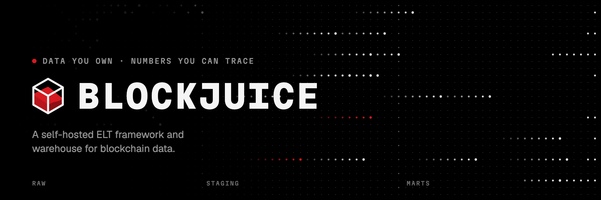

# BlockJuice

[](https://github.com/iankressin/block-juice/actions/workflows/ci.yml)



A self-hosted ELT framework and warehouse for blockchain data. You can trace any number it gives you back to raw rows, and rebuild it.

## Ask a question, get an answer you can check

In Claude Code, from this repo:

```text
/bj How many Uniswap v3 swaps traded UNI on Ethereum on 2026-10-15, and what was their volume in UNI?
```

BlockJuice loads the swaps into your Postgres, builds the dbt models, runs the analysis and writes a folder:

```text
answers/uni-v3-uni-swaps-2026-10-15/
├── question.yaml   the question, its definitions, its window and its inputs
├── answer.json     the value, the SQL of each analysis, the checks, the git commit
├── answer.md       the method and the caveats, in prose
└── results/        one CSV per analysis
```

The answer is **3,529 swaps and 812,886.52 UNI, across 21 pools**. The folder also says why you can trust it:

| Check | What it found |
|---|---|
| `dbt_tests` | 112 passed |
| `dead_letters` | 0 pending and 0 parked, on every source the answer reads |
| `freshness` | The time each source's last run finished |
| `coverage` | `ethereum.uniswap_v3` loaded blocks 26194189 to 26201364, the whole day |
| `cross_check` | One pool's 42 Swap logs, counted again straight from SQD Portal |

It lists what it left out too: counting UNI on one side only would roughly halve the volume, and v2 and v4 pools are not counted.

`bj report` turns the folder into an XLSX workbook, a PDF, a DOCX or a Google Doc.

## Try it with one command

You need [uv](https://docs.astral.sh/uv/) and Docker. You don't need Node, an RPC key or Claude.

```sh
git clone https://github.com/iankressin/block-juice && cd block-juice
uv run --project orchestration bj demo
```

The demo starts its own throwaway Postgres, builds the real balance models from six synthetic readings, checks that the answer is 3.75 ETH and writes an XLSX report under `.demo/`. [docs/demo.md](docs/demo.md) explains each step.

## Why

- **You keep the data.** Raw rows, marts, the run log and the answers live in a warehouse and a repo you run, under keys and policies you set.
- **Every number traces back.** An answer names its SQL, the runs that loaded its inputs and the commit that built it. When a client or an auditor asks how you got a number, you show them.
- **Failures show.** BlockJuice keeps a failed call as a dead letter and retries it on the next run. Each answer checks its inputs for dead letters, stale runs and gaps in coverage before it gives a value.
- **You can change the rules.** Sources only load. Every join, sign rule, unit and price lives in dbt SQL, so you fix a wrong rule and rebuild without fetching anything again.

## What it covers

[Check the full catalog here](https://blockjuice.asof.sh/catalog/)

Each table lives in the `analytics` schema of your warehouse. A source reads only the wallets, tokens, feeds and contracts you list in its `addresses.json`, so a table covers the addresses you follow, not the whole chain.

| | Ethereum | Arbitrum | Base | Polygon | Solana | Bitcoin | HyperCore | Binance, Coinbase |
|---|:---:|:---:|:---:|:---:|:---:|:---:|:---:|:---:|
| [Balances](docs/tables.md#balances) | ✓ | | | | ✓ | ✓ | | |
| [Transfers](docs/tables.md#transfers) | ✓ | ✓ | ✓ | | | | | |
| [DEX trades](docs/tables.md#dex-trades) | ✓ | | | | | | | |
| [Bridges](docs/tables.md#bridges) | | ✓ | ✓ | | | | | |
| [Labels](docs/tables.md#labels) | | ✓ | ✓ | | | | | |
| [Tokens](docs/tables.md#tokens) | ✓ | ✓ | ✓ | | | | | |
| [Exchange prices](docs/tables.md#exchange-prices) | | | | | | | | ✓ |
| [Oracle prices](docs/tables.md#oracle-prices) | ✓ | ✓ | ✓ | | | | | |
| [Polymarket](docs/tables.md#polymarket) | | | | ✓ | | | | |
| [HyperCore fills](docs/tables.md#hypercore-fills) | | | | | | | ✓ | |
| [HyperCore actions](docs/tables.md#hypercore-actions) | | | | | | | ✓ | |
| [Accounts](docs/tables.md#accounts) | ✓ | | | | | | | |
| [Deployments](docs/tables.md#deployments) | ✓ | | | | | | | |
| [CoW ETH Flow](docs/tables.md#cow-eth-flow) | ✓ | | | | | | | |

[docs/tables.md](docs/tables.md) says what a row of each table is, where it comes from, and lists every column with its type.

## How it works

```text
chains and APIs ─▶ sources ─▶ raw.* ─▶ dbt models ─▶ analytics.* ─▶ bj answer ─▶ answers/<slug>/
```

TypeScript sources load raw rows into Postgres. dbt builds the models on top of them. Dagster runs each pipeline, which is a group of marts and everything they read, on its own schedule, and the `ops` schema logs every run. Docker runs the warehouse, eRPC, Dshackle, Prometheus and Grafana. [docs/architecture.md](docs/architecture.md) has the details.

## Run it on your own data

You need Node 24 and [pnpm](https://pnpm.io) (both pinned in `mise.toml`), [uv](https://docs.astral.sh/uv/) and Docker. No `.env` value is required: the defaults read public RPCs and the keyless SQD Portal.

```sh
uv run --project orchestration bj install   # the .env files, the pnpm packages, the dbt manifest
uv run --project orchestration bj dev       # the Docker stack, the setup checks, then Dagster at localhost:3000
```

Then:

1. List the wallets and tokens you follow in each source's `addresses.json`.
2. Materialize a pipeline in Dagster, or run `bj run <pipeline>`. Schedules start stopped, so turn one on under **Automation → Schedules** if you want daily runs.
3. Ask with `/bj`. To work without an assistant, follow the [analysis authoring guide](docs/analysis-authoring.md).

If something looks wrong, run `bj doctor` first. [Local setup](docs/architecture.md#local-setup-detail) covers ports and network settings, and [Scheduling and concurrency](docs/scheduling.md) covers running every pipeline together.

## Extend it

To cover another wallet list, chain or protocol, copy a source with `bj new-source` and add its models in dbt. A pipeline is a mart folder plus one entry in `PIPELINES`. The `/bj` skill runs each of these for you, and [Add a source](docs/architecture.md#add-a-source) and [Add a pipeline](docs/architecture.md#add-a-pipeline) list the steps by hand. Before anyone writes SQL against a protocol, its contracts, events and ABIs go into `catalog/`, each proven on a real transaction.

## Code map

Each folder with code has a README that lists what it exports, the rules its code keeps and what it changes outside itself.

| Folder | What it holds |
|---|---|
| [ingestion/](ingestion/README.md) | TypeScript sources that load raw rows, and the library they share. |
| [transformation/](transformation/README.md) | The dbt project: staging, intermediate and mart models, macros and analyses. |
| [orchestration/](orchestration/README.md) | Dagster assets, pipelines and schedules, and the `bj` CLI. |
| [infra/](infra/README.md) | The Docker stack's settings, the Grafana dashboards and the Postgres setup SQL. |

[CONTRIBUTING.md](CONTRIBUTING.md) has the rules that hold across layers, what the framework writes and the checks to run before a pull request.

## Docs

| Doc | Read it for |
|---|---|
| [docs/demo.md](docs/demo.md) | What the one-command demo builds and proves |
| [docs/tables.md](docs/tables.md) | Every table and column |
| [docs/architecture.md](docs/architecture.md) | Layout, data flow, CLI reference, monitoring, adding sources and pipelines |
| [docs/analysis-authoring.md](docs/analysis-authoring.md) | Writing a question and its analyses by hand |
| [docs/scheduling.md](docs/scheduling.md) | Schedules and warehouse-wide limits |
| [GLOSSARY.md](GLOSSARY.md) | Terms: source, stream source, call, record, run, dead letter |
| `.claude/skills/blockjuice/` | The skill's workflows, from question to report |

## Status

BlockJuice is in active development. For now the framework is this repository: clone it and you have your own warehouse. We're working on thinner packaging. The parts analysts touch (source names, mart shapes and `bj`) should stay the same when it ships.

## License

BlockJuice is licensed under the [Apache License 2.0](LICENSE). Dependencies and externally sourced data retain their respective licenses and terms.
